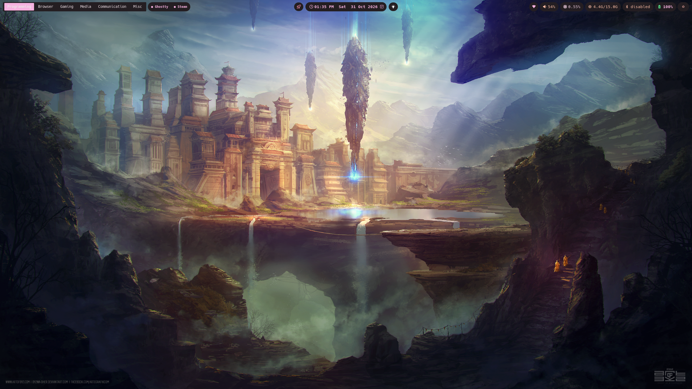
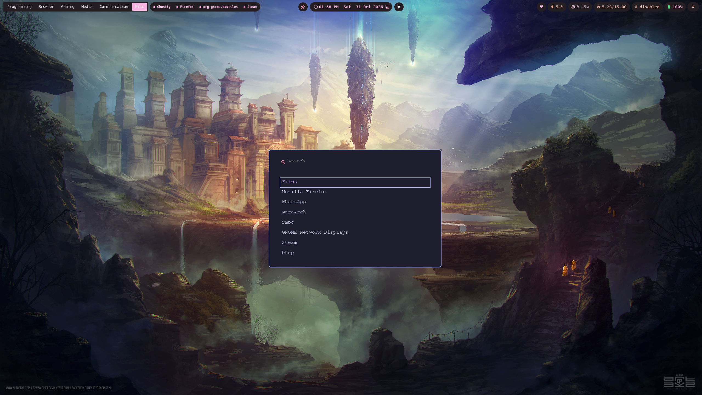
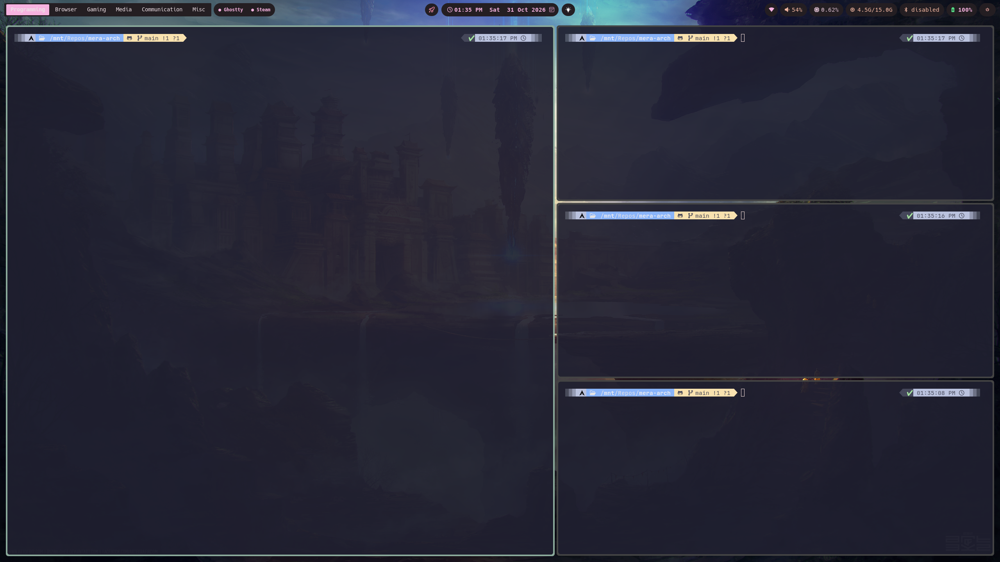

Mera-Arch(MAY-rah or meh-rah) it translates to "MY" and is taken from the Hindi word 'mera'. Its meant to signify a customization of Arch for
myself and through my vision.

## Tools included

- Wofi(overall search)
- Programming: Ghostty + Tmux + neovim
- Gaming: Steam
- Media: Stremio and Rmpc Media for music
- Communcation: Whatsapp and Signal

## Screenshots

